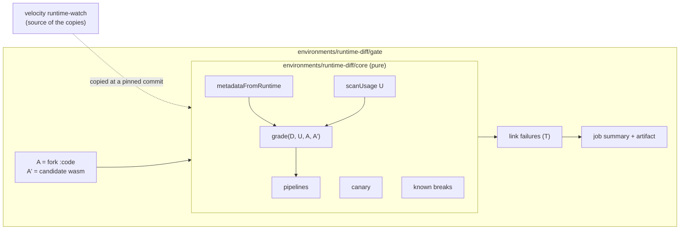

# Design: the runtime diff in the Release Gate

Status: draft · Issue: [#56](https://github.com/paritytech/polkadot-pop-e2e/issues/56) · Author: Andrzej Sulkowski · 2026-10-30

## 1. Problem

When the Release Gate fails, the run shows which tests failed and nothing else. To find the runtime
change that caused it, someone reads chain metadata and product-sdk code by hand.

[Runtime Watch](https://paritytech.github.io/velocity/runtime-watch/) in
[paritytech/velocity](https://github.com/paritytech/velocity) already does part of this for
published People releases. The gate should print the same kind of analysis for the runtime it is
about to upgrade to, and put each failing test next to the change that most likely broke it.

## 2. Goals and non-goals

Goals:

1. For every chain the gate upgrades, grade the candidate runtime against what the pinned
   product-sdk needs: names (Rule 1), types (Rule 2), transaction extensions (Rule 3).
2. Put each failing test next to the diff entries it touches.
3. Write the result to the job summary, upload it as an artifact, and link a prefilled
   `runtime-break` issue on product-sdk when a breaking change explains a failure.
4. Reuse Runtime Watch's code by copying it, with a header naming the velocity commit it came
   from, instead of writing it a second time.

Non-goals:

- **Checking behaviour.** These checks are static. They catch drift early; the chain tests remain
  the proof that the runtime behaves. A clean diff does not mean the run passes, and a breaking
  entry does not mean a test fails.
- **Failing the gate.** For now the diff only explains. Section 9 asks whether it should block.
- **Grading what no product-sdk package uses.** Pallets the SDK never reads are out of scope.

## 3. The model

### Inputs

| Symbol | Part | What it is | Where it comes from |
|---|---|---|---|
| **A** | live runtime | every call, storage item, constant, event, runtime API, view function and extension pipeline, with its type | `:code` read from the fork before the upgrade, or a `.wasm` file |
| **A'** | candidate runtime | the same, for the new runtime | the release `.wasm` the manifest pins |
| **D** | SDK descriptors | the metadata the SDK was generated from: the type it expects for every entry | `@parity/product-sdk-descriptors`, at the version the chain tests install |
| **U** | SDK usage | the **names** the SDK's code reads or calls | scan of each SDK package's `dist/*.js`, following aliases such as `const query = chain.individuality.query.Game` |
| **R** | requirements | each name in U with its type from D (when D has it) and its direction | built from U and D |
| **T** | test usage | the names each test file reads, itself and through the SDK packages it imports | the same scan over `packages/chain-tests` |

U is not always a subset of names(D). The SDK also reads through the unsafe API and through
chains its descriptors do not cover. Those names get Rule 1 only: there is no expected type to
grade against.

### The function

```
report = grade(D, U, A, A')
```

The issue states it as `f(A', R)`. A is added for one reason: to tell a change this upgrade
introduced from one the live chain already had (section 4.4). Every grade is the SDK's
expectation (D) against a runtime, never A against A' directly. A against A' only explains *where*
an entry changed (the type path).

## 4. Rules

### 4.1 Rule 1: names

Every name in U must exist in A'. A name missing from A' is `Missing`. A name missing from both A
and A' is `Missing (already on live)`: the SDK reads it optionally, or was already broken.

Names are only checked on a chain that has the pallet (or API) on at least one side, so a People
selector says nothing about Asset Hub.

### 4.2 Rule 2: types

Each entry is a set of values. Which set must fit inside which depends on who encodes and who
decodes:

| Kind | SDK encodes | SDK decodes | Graded side |
|---|---|---|---|
| `tx` (call) | arguments | — | args |
| `event`, `constant` | — | value | values |
| `query` (storage) | keys | value | the worse of the two |
| `api`, `view` | inputs | output | the worse of the two |

Example: a call argument's enum gains a variant. The SDK's old values still fit, so it is safe. A
returned enum gains a variant: the SDK can now receive a value it cannot decode.

polkadot-api's `@polkadot-api/metadata-compatibility` grades exactly this, and it is the same code
polkadot-api runs when a client calls `isCompatible`. We use it as is:

| Level | Meaning |
|---|---|
| `Identical` | the two value sets are equal |
| `BackwardsCompatible` | the inclusion holds |
| `Partial` | the inclusion holds only for some values |
| `Incompatible` | the inclusion does not hold, or the entry is gone |

### 4.3 Rule 3: transaction extensions

Each extension version (`extensionsByVersion`) is an **ordered list**, and the signer must build
exactly that list, in that order. Per version, compared against D:

| Change | Grade |
|---|---|
| a new version | additive |
| a version removed | breaking |
| an extension added, removed or reordered within a version | breaking |
| an extension keeps its name, its `type` or `additionalSigned` changes | graded like Rule 2 (both are encoded by the signer) |
| an extrinsic version removed | breaking |
| an extrinsic version added | additive |

Extensions that leave one version for another are reported as a move ("`AsPerson`, `AsLiteAlias`
moved from v0 to v1"), because that is how the change is discussed and how product-sdk fixes it.

Extension changes count only on chains the SDK has a descriptor for: it signs nowhere else.

Rule 3 is the coarsest rule. A signer that builds extensions from the runtime's metadata survives
some reorders. Section 6.3 adds Runtime Watch's canary, which builds real transactions with the
SDK, to confirm or clear a Rule 3 hit.

### 4.4 Verdict per entry: the Partial policy

Each entry gets two levels: `before = level(D, A)` and `after = level(D, A')`. The verdict depends
on the transition, not on `after` alone. This is the policy agreed in the issue: a new `Partial`
breaks, a `Partial` that was already there on live does not.

| before | after | Verdict |
|---|---|---|
| any | `Identical` / `BackwardsCompatible` | ok |
| `Identical` / `BackwardsCompatible` | `Partial` | **breaking** (new Partial) |
| `Partial` | `Partial` | pre-existing |
| better than `Incompatible` | `Incompatible` | **breaking** |
| `Incompatible` | `Incompatible` | pre-existing |
| `Incompatible` | `Partial` | pre-existing (improved) |

As code: `breaking = after < before && after < BackwardsCompatible`. Pre-existing entries stay in
the report, marked, so a reader sees them without blaming this upgrade for them.

The same rule applies to Rule 1 (`Missing` is `Incompatible`) and to Rule 3's type changes.

## 5. The report

One report per gate run, one section per upgraded chain.

```ts
type Level = "Identical" | "BackwardsCompatible" | "Partial" | "Incompatible";
type Verdict = "ok" | "breaking" | "pre-existing";

interface EntryResult {
  selector: string;            // "tx:Game.sign_up", "query:Score.Participants"
  rule: "name" | "type";
  before: Level;               // D against A
  after: Level;                // D against A'
  verdict: Verdict;
  paths: { side: "args" | "value"; path: string }[];  // where A and A' differ
  usedBySdkCode: boolean;      // in U, not only in D
  sdkPackages: string[];       // which packages read it
}

interface PipelineResult {
  version: number;
  status: "same" | "changed" | "added" | "removed";
  verdict: Verdict;
  descriptor: string[]; live: string[]; candidate: string[];
  added: string[]; removed: string[]; reordered: boolean; retyped: string[];
}

interface ChainReport {
  chain: string;
  live: RuntimeVersion; candidate: RuntimeVersion;   // spec, tx version, code hash
  descriptor: string | null;                          // which descriptor chain D came from
  entries: EntryResult[];
  extensions: { versions: PipelineResult[]; moved: Move[]; summary: string };
  canary?: CanaryResult;                              // section 6.3
  error?: string;                                     // this chain could not be diffed
}
```

Entries are sorted breaking first, then entries the SDK's own code reads (in U), then the rest.
Entries that are only in D (generated, never read by SDK code) are listed under a collapsed
"descriptor only" heading: a dapp can still use them through the typed API, but they did not
cause a gate failure through the SDK.

### Linking failures (T)

For each failing test (from junit), list the diff entries it most likely hit, best first:

1. An entry the error message names (`Incompatible runtime entry Tx(Game.sign_up)`).
2. An extension change, when the error names an extension or is a rejected transaction
   (`BadProof`, `InvalidTx`, ...).
3. A breaking entry the test reads, itself or through an SDK package it imports.
4. An extension change, when the test signs on that chain.

Additive changes link only when the error names them. A failure with no link says the cause is
unknown rather than guessing.

### Outputs

- Job summary: failing tests with their links, then per chain the breaking entries, the extension
  table and the missing names.
- Artifact `runtime-diff/`: `diff.json`, `report.json`, `report.md`, and each side's metadata as
  `<chain>.{live,candidate}.scale` so anyone can rerun the grading locally.
- When the run failed and a breaking change explains it: a link to a prefilled `runtime-break`
  issue on product-sdk.

## 6. Architecture and reuse of Runtime Watch

### 6.1 What exists today

| Piece | Runtime Watch (velocity) | Gate (this branch, `environments/runtime-diff/`) |
|---|---|---|
| Metadata from a `.wasm` | `metadata.ts` | `metadata.ts`, copied from velocity |
| Live runtime | — (compares against D) | `:code` from the fork |
| SDK usage scan (U) | `discoverSdkSurfaces`: follows aliases, `individuality` only, sanity floor on counts | `selectorsIn`: any chain, no alias following |
| Type grading | JSON equality of shapes: every change is "breaking", no direction | `metadata-compatibility`, direction-aware, Partial policy |
| Extension pipelines | equality of the whole map, plus a "moved" summary | per version, ordered, type-graded, "moved" summary |
| Behavioural check | canary: builds 4 SDK transactions offline against the metadata | — |
| Known breaks | `known-breaks.json` + `diagnosis.ts` | — |
| Linking tests (T) | — | `links.ts` |
| Output | `status.json`, static HTML, GitHub issue | job summary, artifact, issue link |

Velocity's package is private with no exports, and its CLI is tied to GitHub releases and
`status.json`. It cannot be called as a library or CLI from the gate as it is. The gate's grading
is the more precise half; velocity has the alias-following scan, the canary and the known-break
catalogue.

### 6.2 Decision: copy, don't extract

The gate copies the parts of Runtime Watch it needs into this repo. It does not turn Runtime Watch
into a shared library or CLI.

| | Copy into this repo | Shared library or CLI in velocity |
|---|---|---|
| Code involved | alias scan (~40 lines), canary (~300), `known-breaks.json` + diagnosis (~180) | the same, plus restructuring velocity |
| Extra work | none | workspace package, exports, a build step (velocity runs raw `tsx`), npm publish or a pinned git dependency |
| `@polkadot-api/*` versions | ours | velocity pins `metadata-builders@0.14.3`, we use `0.15.2`; one side must move |
| Effect on Runtime Watch | none | switching its `diffFacts` to our grading changes its verdicts, `status.json` and alerts |
| Who decides | this repo | velocity maintainers, on their schedule |
| Estimate | ~1 day | ~3–5 days, plus review in velocity |

The cost of copying is drift. It stays small because the copied pieces are small, they are pinned
to the SDK version the chain tests install, and section 6.5 says how to resync them.

### 6.3 Layout



`core/` is pure: bytes and module objects in, plain data out. No network, no file layout, no
GitHub. Its surface:

```ts
metadataFromRuntime(wasm: Uint8Array): Uint8Array
scanUsage(sources: string[]): Usage                    // U, with alias following and a sanity floor
grade(d: Descriptor, u: Usage, a: Metadata, a2: Metadata): ChainReport
runCanary(sdk: SdkModule, metadata: Uint8Array): CanaryResult
diagnose(report: ChainReport, canary: CanaryResult): KnownBreak | null
```

`gate/` holds what is specific to the Release Gate: reading the fork's `:code`, the upgrade plan,
junit, test linking and the markdown.

Keeping `core/` pure is also what keeps the door open: if velocity later wants direction-aware
grading, `core/` is the piece to offer them, and nothing in it depends on this repo.

### 6.4 What the gate copies from Runtime Watch

1. **The alias-following scan** (`discoverSdkSurfaces` in `metadata.ts`), generalised from
   `individuality` to any chain, with its sanity floor: a minifier change that hides every
   selector must fail loudly, not report "no usage".
2. **The canary** (`canary.ts`). It builds real SDK transactions offline against A'. A Rule 3 hit
   with a passing canary is downgraded to "changed, SDK still signs"; a failing canary with no
   Rule 3 hit is reported as a breaking change the static rules missed.
3. **`known-breaks.json`** and the matching part of `diagnosis.ts`. A break that matches a known
   entry gets its explanation, fix and tracking issue in the report instead of a fresh issue link.

Not copied: release discovery, `status.json`, the HTML, the deployment probes and the GitHub issue
sync. The gate has its own versions of each, or does not need them.

### 6.5 Keeping the copies honest

- Every copied file starts with a header, as `metadata.ts` already does:

  ```ts
  // Copied from Runtime Watch (paritytech/velocity, runtime-watch/src/canary.ts at <sha>, <date>).
  // Changes: <what differs and why>.
  ```

- `known-breaks.json` is data, not code: copy it whole and record the velocity commit in the
  same header comment of the module that loads it.
- Resync when the chain tests bump `@parity/product-sdk-*`, because that is when the canary and the
  scan are most likely to break. The bump PR diffs each copied file against velocity's `main` and
  either pulls the change or notes why not.
- The copies use this repo's `@polkadot-api/*` versions, the same ones the SDK under test uses:
  the grading is only right if it is polkadot-api's own.

## 7. Where it runs in the gate

```
Decide which runtimes to upgrade
Capture the runtime diff        <- A from the fork's :code, A' from the plan's wasm; writes diff.json
Upgrade each chain's runtime
Run the chain tests             <- one junit file per script
Explain the run                 <- if: always(); joins diff.json with junit; job summary
Upload the runtime diff         <- artifact
```

Both new steps are `continue-on-error`: a diff that cannot be computed is recorded and never fails
the gate. Capture runs before the upgrade because it is the last point the fork still runs live's
code. It has a 10 minute timeout.

## 8. Plan

| Phase | What | Where | Estimate |
|---|---|---|---|
| 0 | Gate diff with the rules above, wired into the workflow | this branch, done | — |
| 1 | Split the code into `core/` (pure: grade, pipelines, scan) and `gate/` (capture, links, markdown); grade against D, with A only for the before level | this repo | 1 day |
| 2 | Copy velocity's alias-following scan into `core/scanUsage`, with its tests | this repo | half a day |
| 3 | Copy the canary and `known-breaks.json` into `core/`; run them in the gate and show them in the report | this repo | 1 day |
| later, optional | Offer `core/`'s grading to velocity as a PR, if they want direction-aware verdicts | velocity | not planned |

Nothing here waits on velocity.

## 9. Open questions

1. **Should a breaking verdict fail the gate?** Today the diff only explains. Failing on it would
   catch a break the tests do not cover, at the cost of false positives from Rule 3.
2. **Rule 3 strictness.** Is "any add, remove or reorder is breaking" right for extensions the
   signer builds from the runtime's metadata, or only for the ones the SDK builds itself (the
   person extensions)? The canary answers it per case; the static rule needs a default.
3. **Grading against D or against A for extensions.** This doc grades against D, like everything
   else. On previewnet, A can already differ from D (descriptors are generated from Paseo); the
   before/after transition absorbs that, but the report must say which side a difference is on.
4. **Resync trigger** (6.5): is "on every product-sdk bump" enough, or should a scheduled job diff
   the copied files against velocity's `main` and open an issue when they differ?
5. **Descriptor-only entries.** Report them collapsed (this doc), or drop them to keep the
   summary short?
