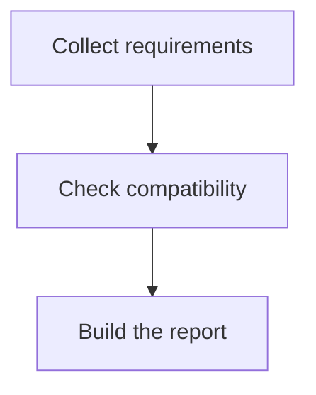

TODO: Do a proper high level description doc
Should not be a AI generated description. So my dear AI DONT TOUCH THIS DOC!

## Purpose

With this CLI tool we want to detect potential incompatibilities of runtime upgrades with downstream JS/TS consumers.


## Scope

This CLI scans selected JavaScript/TypeScript code for chain accesses through PAPI. For the entries it identifies, it checks the live and candidate runtime metadata against the metadata used to generate the consumer’s existing PAPI descriptors.

**The descriptor metadata is not necessarily the live runtime metadata.** Descriptors stay pinned until the consumer updates them, while the chain may have undergone several upgrades:

```text
 Consumer’s descriptors → generated from runtime v1
 Live chain             → running runtime v2
 Candidate upgrade      → runtime v3
```

Checking both v2 and v3 against the consumer’s v1 expectations distinguishes incompatibilities introduced by the candidate from mismatches already present on the live chain.


## Approach



1. **Collect requirements.** Identify the consumer’s PAPI chain accesses and their expected types using its existing descriptor metadata.
2. **Check compatibility.** Evaluate live and candidate independently against those requirements.
3. **Build the report.** Distinguish SDK regressions from existing mismatches and show what changed between live and candidate.

## Results and limits

The tool produces Markdown and JSON reports containing:
- Compatibility results for the live and candidate runtimes.
- New or worsened incompatibilities, distinguished from existing mismatches.
- A metadata diff showing changes within the checked scope.

This tool checks metadata compatibility, not runtime behavior. A runtime upgrade can remain compatible at the metadata level while changing behavior the consumer relies on. Coverage also depends on which PAPI accesses the scanner can identify.

See [Technical details](TechDetails.md) for how each step works, including which access patterns the scanner detects and which it misses.


# Q&A
## Why not just run TSC?

We could go into the SDK's, replace the descriptors with the updated runtime descriptors, but it could lead to not reporting breaking changes.

Suppose the SDK exports:

```ts
export async function totalScore() {
  return chain.individuality.query.Score.Total.getValue();
}
```

The runtime changes `Score.Total` from `u128` to `u32`.

### Regenerate descriptors and run TSC

Both versions compile successfully under `--strict`. However, their emitted declarations differ:

```ts
// Original descriptors
export declare function totalScore(): Promise<bigint>;

// Candidate descriptors
export declare function totalScore(): Promise<number>;
```

**The SDK builds, but its public contract changed.** Existing consumers expecting a `bigint` are not checked when compiling the SDK alone.

### Current metadata check

Keeping the published SDK’s metadata as the expectation, the result was:

```text
Live:      Identical
Candidate: Incompatible
Verdict:   breaking
```

It catches the mismatch between what the **existing SDK expects** and what the candidate runtime provides.
