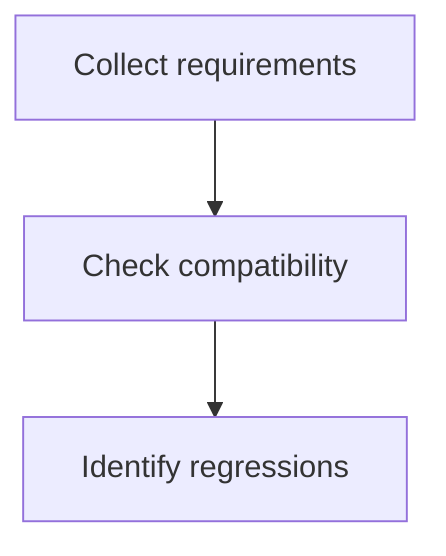

# Technical Design



## 1. Collect requirements
Start here. Explain:
- How SDK code and descriptor metadata are located.
- Which PAPI access patterns are recognized, using the examples already in [TechDetails.md](worktree://967f9aca-1626-4247-845c-79c313d4bc71/environments/meta-check/TechDetails.md#L1).
- How accesses are assigned to chains and paired with expected types.
- What happens when the chain cannot be identified or the descriptor lacks an entry.


This first step can be split into first detecting and secondly enriching.

We detect inside the JS/TS code accesses to the chain interface exposed through PAPI. This is done by the `runtime-access` module.

### Runtime Access Module

This module is accessed through `class RuntimeAccesses` which gets constructed through the `static scan(..dirs: string[])` method.


exported function `readsIn`. It parses one JS/TS file at a time and walks its syntax tree. It uses the TypeScript compiler API to find where local names were declared and builds a access array (`type AccessPath = PathPart[];`).

1. **Find the property access.** The scanner picks up `tx.Game.sign_up`.
2. **Follow the alias.** The local `const` declaration tells it that `tx` stands for `chain.individuality.tx`.
3. **Recognize the entry.** From `chain.individuality.tx.Game.sign_up`, it records `tx:Game.sign_up` on `individuality`, along with the file and line. If it recognizes the entry but can’t identify the chain, it leaves the chain unknown.


> This is a syntax-based scan: it recognizes the shape of a PAPI access without verifying that the object is actually a PAPI client. 
> See the [skipped detection tests](runtime-access/test.ts#L155) for known gaps, including bracket notation, and the [SDK batch test](runtime-access/test.ts#L382) for a real example.


At the end we get a object like:

```js
const access = {
  selector: 'tx:Game.sign_up',
  chain: 'individuality',
  optional: false, //if the call is optional (?)
  file: 'packages/individuality/src/registration.ts',
  line: 12, 
};
```

### Requirements Module

Once accesses are assigned to chains, `buildRequirements` creates one `Requirement` per chain and selector. This lets us check each entry once per chain while keeping every source location

For each `Requirement`, the builder looks up the selector in that chain’s descriptor metadata. Here’s an abbreviated `Requirement` for `constants:System.BlockHashCount` on `individuality`. The descriptor says the constant takes no input and has a `u32` output:

```js
  const requirement = {
    selector: "constants:System.BlockHashCount",
    expected: {
      encoding: {
        input: null,
        output: { type: "primitive", value: "u32" },
      },
    },
  };
```

Here we need to account for multiple cases:

1. **Chain detected, descriptor present, entry found:** store the descriptor entry as `expected`.
2. **Chain detected, descriptor present, entry not found:** keep the requirement with `expected: null`; the checker can only check whether the runtime has the entry.
3. **Chain detected, descriptor not supplied:** keep the access in `unplaced`. The chain might simply be outside this run.
4. **Chain not detected**
   - **4.1 Find matching chains.** Consider every supplied descriptor. If it contains the pallet or runtime API named in the selector, include its chain. If none match, put the access in `unplaced`.
   - **4.2 Look up the entry on each matching chain.** Use the full selector to find the entry in that chain’s descriptor. If the entry is found, store it as `expected`. If not, still create the requirement, but set `expected: null`.
   

The builder returns a `RequirementSet` with two fields: `chains`, the requirements grouped by chain, and `unplaced`, the accesses that couldn’t be assigned.


## 2. Check compatibility

`check` from the "Check Module" grades one runtime against the SDK’s `Requirements`.
The signature is: `check(requirements: Requirements, runtime: Runtime): RuntimeCheck`.

### Entries

A metadata entry is a named item in the chain’s metadata, such as a transaction call, a storage item, an event, or a constant. For example, `constants:System.BlockHashCount` identifies one constant. A `Requirement` tells us which entry the SDK uses and, when known, what types it expects.

For each `Requirement`, the checker looks up its selector in the runtime metadata.

1. **The runtime doesn’t have the entry:** return `Missing`.
2. **The runtime has the entry, but `expected` is `null`:** return `Present`. The entry exists, but there’s no expected type to compare against.
3. **The runtime has the entry and the `Requirement` has an expected type:** compare the types as described in [Grading](#grading).

### Grading

We use PAPI’s `@polkadot-api/metadata-compatibility` library to compare the types the SDK expects with those in the runtime metadata. PAPI gives us two grades: 

- **Input compatibility:** Can the runtime accept the values the SDK sends?
- **Output compatibility:** Can the SDK read the values the runtime returns?

From strongest to weakest compatibility, the grades are 
- `Identical`
- `BackwardsCompatible`
- `Partial`
- `Incompatible`

Our checker uses the input grade when the SDK only sends data, the output grade when it only reads data, and the weaker of the two when it does both.

For example, the SDK only reads `constants:System.BlockHashCount`, so the checker uses the output grade. It compares the runtime’s output type against the expected `u32`.

#### Transaction Extensions

On chains with a `tx:` requirement, the tool makes two comparisons for each extension version:

| Comparison | Question it answers | Result |
|---|---|---|
| SDK descriptor ↔ each runtime | Can the SDK still build transactions on this runtime? | Compatibility grade, then the regression verdict |
| Live ↔ candidate | Did an existing version change in place? | Version-lock violation |

The report counts the two results separately, and they can disagree: a version can be compatible with the SDK and still violate the version lock.

**SDK compatibility.** `check` grades each version against the SDK descriptor's, as it grades an entry:

- `Missing`: the runtime lacks a version the SDK expects.
- `Present`: only the runtime has the version, so there is nothing to compare.
- `Incompatible`: the extension identifiers differ, or are in a different order.
- Otherwise: the weakest input grade across the extensions' types (`type` and `additionalSigned`).

**Version lock.** Existing versions must stay unchanged so clients can continue using them. If the format needs to change, publish a new version alongside the old one.

- **Version added:** Report the addition. Adding `v2` alongside an unchanged `v1` is not a violation.
- **Version removed:** Report the removal. If the SDK expects that version, its compatibility grade becomes `Missing`.
- **Version present on both runtimes:** The extension identifiers must match in order, and each extension must keep the same SCALE types for its transaction data (`type`) and signing data (`additionalSigned`). Any change is a **version-lock violation**, whatever the SDK compatibility grade.

## 3. Identify regressions
Explain the verdict rules and how the independent live/candidate metadata diff contributes diagnostics to the final report.

### Regression

### Diff

### Report

--- $$$$

We look up this entry in the metadata used to generate the SDK's existing PAPI descriptors. By doing so we can find out what the current descriptors expect for a type.

```js
{
  selector: access.selector,
  expected: descriptor.entry(access.selector) ?? null,
  accesses: [access],
  placedBy: 'chain',
}
```

The requirement also derives `direction` from the selector (`encode` for `tx`) and `optional` from whether all its accesses are optional.


In the next step we look into the runtime metadata which derived the PAPI descriptors for the SDKs codebase, to decorate the collected endpoints.
